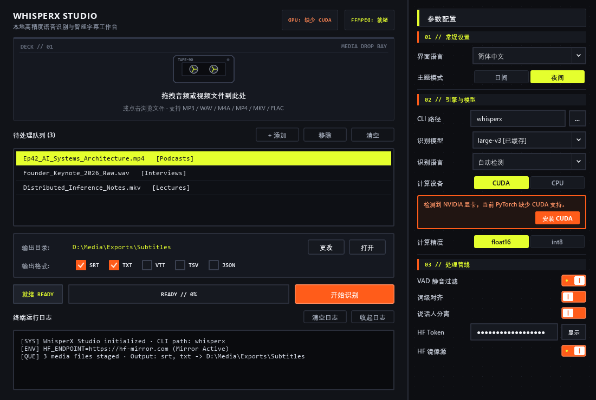
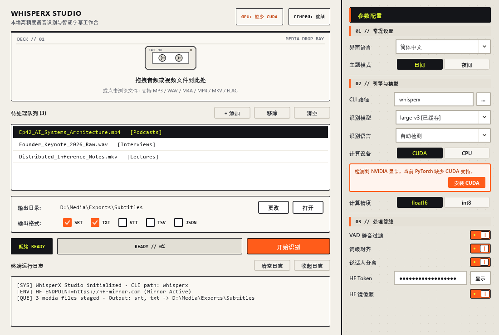
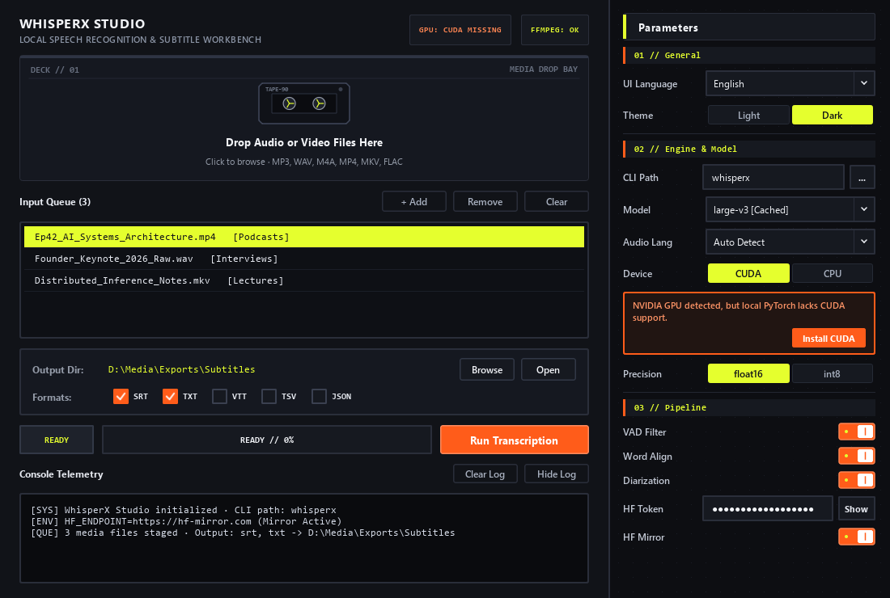

# WhisperX Studio (WhisperX GUI) v2.0.0

<div align="center">

**高精度、本地优先的 WhisperX 语音识别与智能字幕工作台**  
*A Cassette-Futurist, Local-First Desktop Workbench for WhisperX Speech Recognition & Subtitle Generation.*

[](LICENSE)
[](https://github.com/HKDCC/WhisperX-GUI/releases/tag/v2.0.0)
[](https://www.python.org/)
[](https://pypi.org/project/PyQt6/)

[📦 下载 v2.0.0 源码包 (.zip)](https://github.com/HKDCC/WhisperX-GUI/archive/refs/tags/v2.0.0.zip) ·
[🏷️ Release Notes](https://github.com/HKDCC/WhisperX-GUI/releases/tag/v2.0.0) ·
[🚀 安装指南](#-快速下载与安装-download--installation) ·
[📖 五步上手](#-五步零基础使用指南-5-step-usage-guide)

</div>

---

## 💡 WhisperX 是什么？为什么需要 WhisperX Studio？

> **给完全没听说过 WhisperX 的新朋友：**

- **Whisper** 是 OpenAI 开源的语音识别模型，能把音频、视频里的人声转换成文字。
- **WhisperX** 是在 Whisper 基础上大幅增强的开源引擎：它在保留高准确率的同时，显著提升了长音频识别速度，并补齐了**毫秒级词级时间戳对齐**（做字幕不漂移）和**多人说话人分离**（分辨是谁在说话）能力。
- **WhisperX Studio** 则是基于 Python + PyQt6 构建的图形界面工作台：原本运行 WhisperX 需要面对命令行黑框并记忆一长串参数；WhisperX Studio 把整个流程变成了一个**板正直观的桌面控制台**，**100% 本地运行、零云端上传、不按分钟收费**，拖入文件就能出字幕。

---

## 🖼️ 界面预览 (Screenshots)

| 夜间模式（简体中文） / Dark Mode | 日间模式（简体中文） / Light Mode |
| :---: | :---: |
|  |  |

| 英文界面（夜间模式） / English UI (Dark) |
| :---: |
|  |

---

## ✨ 核心亮点 (Key Features)

- 🎙️ **本地优先与极致隐私**：所有音频解码、语音推理与时间戳对齐均在本机完成，无云端上传，保障会议录音与私有素材安全。
- ⚡ **VAD 静音过滤直连**：直连 `--vad_method pyannote` / `--vad_onset` / `--vad_offset` / `--no_speech_threshold`，大幅减少背景空白段的复读与幻觉。
- 🎯 **词级时间戳对齐 (Word-level Alignment)**：支持一键开关音素对齐模型（`--no_align` 控制），兼顾毫秒级字幕卡点与快速纯文本导出。
- 👥 **说话人角色分离 (Speaker Diarization)**：支持 `--diarize` 与本地 Base64 持久化的 HuggingFace Access Token（支持明文/掩码快速切换）。
- 🚀 **国内镜像加速 (HF Mirror)**：内置 `HF_ENDPOINT=https://hf-mirror.com` 环境变量注入开关，并自动扫描 `~/.cache/huggingface/hub` 中的本地 `faster-whisper-*` 离线缓存模型。
- 🎛️ **复古未来主义精密控制台界面 (Cassette-Futurist Console UI)**：
  - **简洁板正的双栏结构**：左侧为任务工作区（`DECK // 01` 磁带舱拖拽区、可增删清空的媒体队列、输出目录与一键打开、多格式勾选保护、阶段状态徽章与进度条、可折叠终端日志抽屉）；右侧为纵轴对齐的 `01 // 常规设置`、`02 // 引擎与模型`、`03 // 处理管线` 参数侧栏。
  - **日夜双主题与双语切换**：日间哑光建筑纸张搭配黑墨高亮锚点，夜间深邃黑曜底色搭配 Signal Orange 与 Volt Yellow 指示色，支持简体中文 / English 实时热切换。
  - **实时硬件诊断与一键 CUDA 修复**：顶部状态栏实时监测 `FFmpeg` 与 `PyTorch CUDA` 状态；检测到 NVIDIA 显卡但缺少 CUDA PyTorch 时，内置安装横幅支持一键拉起 `cu121` 依赖安装并可随时中止。
- 📦 **多格式同步导出**：支持 `.srt`、`.txt`、`.vtt`、`.tsv`、`.json` 多选组合导出（界面保护至少保留一种活跃格式）。

---

## 🚀 快速下载与安装 (Download & Installation)

### 第一步：准备基础环境 (Prerequisites)

1. **Python 3.10 及以上版本**（已验证支持 Python 3.10 – 3.13）
   - 前往 [Python 官网下载](https://www.python.org/downloads/)。
   - ⚠️ **Windows 安装时务必勾选底部的 `Add python.exe to PATH`**。
2. **FFmpeg**（用于音视频解码，必须加入系统 `PATH`）
   ```bash
   # Windows（在 PowerShell 中执行 Winget 一键安装，装完建议重开终端）
   winget install Gyan.FFmpeg

   # macOS (Homebrew)
   brew install ffmpeg

   # Ubuntu / Debian Linux
   sudo apt update && sudo apt install -y ffmpeg
   ```

### 第二步：下载代码并安装依赖

#### 方式 A：直接下载压缩包（推荐零基础用户，无需安装 Git）

1. 点击直链下载开源发布包：👉 [**WhisperX-GUI v2.0.0.zip**](https://github.com/HKDCC/WhisperX-GUI/archive/refs/tags/v2.0.0.zip)（或访问 [Releases 页面](https://github.com/HKDCC/WhisperX-GUI/releases/tag/v2.0.0)）。
2. 解压到本地文件夹，在解压后的目录中打开终端（PowerShell / Terminal），运行下方安装命令。

#### 方式 B：使用 Git 克隆仓库

```bash
# 1. 克隆仓库并进入目录
git clone https://github.com/HKDCC/WhisperX-GUI.git
cd WhisperX-GUI

# 2. （可选但推荐）创建虚拟环境
python -m venv .venv
# Windows 激活：.venv\Scripts\activate
# macOS / Linux 激活：source .venv/bin/activate

# 3. 安装核心依赖与 WhisperX
pip install -r requirements.txt
pip install whisperx

# 4. 启动桌面工作台
python main.py
```

### 第三步（可选）：NVIDIA GPU CUDA 加速

如果你有 NVIDIA 独立显卡，希望获得数倍于 CPU 的转录速度：
- 启动 `python main.py` 后，如果顶部状态栏显示 **`GPU: 缺少 CUDA`**，右侧面板会自动出现 **`安装 CUDA`** 提示横幅——**点击按钮即可自动安装适配版本**（支持随时点击取消）。
- 也可以在终端提前手动安装 PyTorch CUDA 12.1 套件：
  ```bash
  pip install torch torchvision torchaudio --index-url https://download.pytorch.org/whl/cu121
  ```

---

## 📖 五步零基础使用指南 (5-Step Usage Guide)

1. **拖入音视频素材**：将需要转换的音频或视频文件（支持 `.mp3` / `.wav` / `.m4a` / `.mp4` / `.mkv` / `.avi` / `.flac` / `.ogg` / `.webm` / `.mov` / `.aac`），甚至整个文件夹，直接拖进左侧 `DECK // 01` 磁带舱区域，或点击 **`+ 添加`** 批量导入；支持选中后点 **`移除`**（或按 `Delete` 键）以及 **`清空`**。
2. **选择识别模型与语言**：
   - 在右侧 **`02 // 引擎与模型`** 中选择模型：
     - **`large-v3`（默认旗舰）**：准确率最高，推荐中英混杂或复杂场景使用（约需 6 GB+ 显存，也可在无显卡时配合 `int8` 运行）。
     - **`medium` / `small`**：速度与精度均衡；普通笔记本或纯 CPU 体验建议从 `small` 或 `base` 起步。
     - **`tiny`**：极速草稿预览，对硬件要求最低。
   - **识别语言**：通常保持 **`自动检测`**；确认整段均为单一语言（如纯中文 `zh` 或纯英文 `en`）时，手动指定可略微提速并提升专有发音识别率。
   - **计算设备与精度**：有 NVIDIA 显卡选 `CUDA + float16`；无独显时系统会自动锁定为 `CPU + int8` 防止报错。
3. **设定输出目录与导出格式**：
   - **输出目录**：默认与源文件保存在同一目录，可点击 **`更改`** 指定统一输出位置，任务结束后点击 **`打开`** 直达结果文件夹。
   - **输出格式**：视频剪辑加字幕选 **`SRT`**，只需要文字整理或喂给大模型总结选 **`TXT`**，网页播放器选 **`VTT`**，也可多选同时生成 `TSV` / `JSON`。
4. **按需调整处理管线开关（`03 // 处理管线`）**：
   - **`VAD 静音过滤`（推荐开启）**：自动跳过无人声的空白段，避免静音期输出乱码或重复幻觉。
   - **`词级对齐`（推荐开启）**：通过音素对齐模型把字幕时间轴精确到每个词，做视频卡点字幕强烈建议开启；若只需要大致文字稿可关闭以省去额外对齐模型下载与耗时。
   - **`说话人分离`（按需开启）**：适合播客、会议、多人访谈，自动标注不同发言人。需前往 [HuggingFace Tokens](https://huggingface.co/settings/tokens) 生成免费 Read Token 填入面板（并同意 `pyannote/speaker-diarization-3.1` 与 `pyannote/segmentation-3.0` 模型使用协议）。
   - **`HF 镜像源`（国内推荐保持开启）**：自动为识别任务注入 `HF_ENDPOINT=https://hf-mirror.com`，解决首次下载模型权重连接超时的问题。
5. **开始识别与查看结果**：点击醒目的 **`开始识别`** 按钮，顶部状态徽章会变为 **`运行中`** 并驱动进度条；首次使用某一模型时会自动下载权重并缓存在本机，后续即可离线秒开。需要查看细节可点击 **`展开日志`**；全部完成后点 **`打开`** 即可拿到字幕与文本文件。

---

## ⚙️ 配置文件与本地缓存 (Configuration)

应用首次启动时会在系统用户目录自动初始化配置文件（敏感 HuggingFace Token 仅以 Base64 形式保存在本机）：
- **Windows**: `%LOCALAPPDATA%\WhisperX_GUI\config.json`
- **macOS / Linux**: `~/.whisperx_gui/config.json`

参考配置 [`config.example.json`](config.example.json)：

```json
{
    "model_name": "large-v3",
    "device": "cuda",
    "compute_type": "float16",
    "output_formats": ["srt", "txt"],
    "vad_filter": true,
    "align": true,
    "diarize": false,
    "language": "auto",
    "ui_language": "zh",
    "theme_mode": "light",
    "use_hf_mirror": true,
    "whisperx_path": "whisperx"
}
```

---

## 📦 项目结构 (Project Structure)

```text
WhisperX-GUI/
├── core/                         # 核心调度层
│   ├── config_manager.py         # 配置持久化、CUDA/NVIDIA 探测与 Token 编码
│   ├── translator.py             # 中英双语静态词典与视图文案切换
│   └── whisper_runner.py         # QThread 异步调度、CLI 参数构建与进度解析
├── ui/                           # 界面视图层
│   ├── assets/                   # 图标、下拉箭头与复选框资源
│   ├── components/               # 自定义工业风控件
│   │   ├── dropzone.py           # DECK // 01 磁带舱拖拽与文件导入区
│   │   ├── ios_switch.py         # 平直硬件拨动开关
│   │   ├── segmented_control.py  # 平直高对比分段选择器
│   │   └── settings_panel.py     # 右侧纵轴对齐参数配置面板
│   ├── crash_dialog.py           # 统一视觉风格的崩溃/缺失依赖诊断弹窗
│   ├── main_window.py            # 主工作台布局、队列管理、CUDA 安装器与日志抽屉
│   └── styles.py                 # 日间/夜间双主题 QSS 样式表
├── docs/screenshots/             # README 界面预览截图
├── main.py                       # 应用程序入口与环境预检
├── requirements.txt              # Python 依赖清单
├── config.example.json           # 默认配置模板
└── LICENSE                       # MIT 开源协议
```

---

## 📄 开源协议 (License)

本项目基于 [MIT License](LICENSE) 协议开源。
